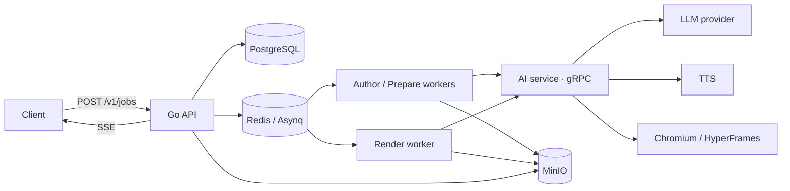

# ReasonFrame · 理象

> 从一道数理化题目生成经过独立审核的讲解视频。

[](backend/go.mod)
[](ai-service/package.json)
[](deploy/compose.yaml)
[](docs/architecture.md)
[](CONTRIBUTING.md)

ReasonFrame 输入题目图片或文本、学段与知识范围、补充要求，生成一份可下载的 1080p 讲解视频。系统把“解题与讲稿”和“画面与成片”拆成两个独立作者/审核循环，只有答案审核、视频审核、音频对齐、浏览器检查、HyperFrames 检查和成片验证全部通过后才发布视频。

## 为什么

- **答案和画面分开审。** 先让答案 agent 解题、写讲稿并由独立 reviewer 审核；通过后才让视频 agent 设计画面，再由另一个独立 reviewer 检查实际预览帧。
- **作者保留上下文，审核者互不污染。** 作者跨返修轮保留会话；每一轮 reviewer 使用全新上下文，只读取当前产物和报告。
- **不是“生成完就算”。** 公式/数值、讲稿覆盖、词级对齐、高亮对象、布局、动画、编码视频和逐场景 SSIM 都有门禁。
- **异步、可恢复。** PostgreSQL 是事实源，Redis/Asynq 调度，MinIO 保存检查点、音频、报告和成片；失败重试从已验证阶段继续。
- **一条命令启动。** Go 控制面、AI 执行面、PostgreSQL、Redis、MinIO 和 worker 由 Compose 编排。

## 架构



| 组件 | 职责 |
| --- | --- |
| `backend/` | HTTP API、PostgreSQL 状态机、Asynq 队列、SSE、上传/下载、重试与恢复 |
| `ai-service/` | Pi agent、答案/视频双循环、TTS、词级对齐、编译、浏览器检查、渲染与成片验证 |
| `deploy/` | Compose、镜像、环境示例、模型 profile 配置 |
| `proto/` | Go 与 TypeScript 共用的 gRPC 契约 |
| `docs/` | 架构、工作流、配置、TTS、实现记录 |

## 工作流

```text
POST /v1/jobs
  └─ author
       ├─ answer author：独立解题 + 讲解稿 + 结构化 claims
       ├─ 答案 reviewer：全新上下文审核答案、旁白和数值
       └─ 未通过 → 回到同一 answer author 会话返修
  └─ prepare
       ├─ 整篇 TTS / 导入音频 → 词级对齐
       ├─ video author：lesson + visual.js + style.css
       ├─ video reviewer：审核实际预览帧、源码、讲稿和检查报告
       ├─ 未通过 → 回到同一 video author 会话返修
       └─ 编译 + 浏览器 + HyperFrames 检查
  └─ render
       ├─ HyperFrames 渲染 + FFmpeg 转码
       └─ 解码、音轨、帧数、黑帧、SSIM 验证 → 发布 video
```

关键约束：

- 视频作者**不能改写**已批准的答案、claims、model 符号和旁白；旁白变化会使旧音频、时间线和视频缓存失效。
- reviewer 的批准绑定答案/源码/讲稿摘要与 reviewer 提示词摘要；任何绑定变化都会让旧批准失效。
- 渲染失败不会重跑作者；讲稿返修也不会占用渲染并发。
- 无法自动恢复的阶段失败会保留已批准检查点和草稿，支持显式重试。

## 快速开始

### 前置条件

- Docker Engine + Compose v2.24+（`env_file.required`）。
- 仅在本地构建时需要 Go 1.26、Node.js 24。
- 一个兼容 OpenAI Chat Completions 的模型端点；真实生成需要 API key。

### 启动

```bash
cp deploy/.env.example deploy/.env
# 只填 LLM_API_KEY；provider/model 顺序在 deploy/llm_config.json
make infra-up
```

`make infra-up` 会先执行数据库迁移，再启动 PostgreSQL、Redis、MinIO、API、worker、render worker、reconciler 和 AI 服务。API 默认监听 `http://127.0.0.1:4310`。

```bash
curl -X POST http://127.0.0.1:4310/v1/jobs \
  -H 'Content-Type: application/json' \
  --data-binary @ai-service/examples/solid-geometry/request.json

curl http://127.0.0.1:4310/v1/jobs/JOB_ID
curl -N http://127.0.0.1:4310/v1/jobs/JOB_ID/events
```

若设置了 `STATIC_API_KEY`，所有 `/v1` 请求加 `Authorization: Bearer <key>`。MinIO 只绑定本机回环地址；产物通过 API 下载：

```bash
curl -L http://127.0.0.1:4310/v1/jobs/JOB_ID/artifacts/video -o video.mp4
```

### 本地开发

```bash
make test            # AI 核心 + AI gRPC/阶段 + Go 单元测试
make build           # Go 二进制 + AI TypeScript
make compose-config  # 校验 Compose
```

单独运行 AI 服务：

```bash
cd ai-service
npm ci
npm run build
npm start
```

单独运行 Go 控制面：

```bash
cd backend
go test ./...
go run ./cmd/rf migrate
go run ./cmd/rf api
go run ./cmd/rf worker --queues author,prepare
go run ./cmd/rf worker --queues render
go run ./cmd/rf reconciler
```

## 配置

模型 provider、模型顺序、上下文/输出预算和 thinking level 在 `deploy/llm_config.json`。`deploy/.env` 只保存密钥和运行策略；不要把 key 写进配置文件。

```json
{
  "providers": {
    "opencode": {
      "endpoint": "completions",
      "url": "https://opencode.ai/inference/go/openai/v1",
      "apiKeyEnv": "LLM_API_KEY"
    }
  },
  "models": [
    { "provider": "opencode", "model": "longcat-2.5-preview-free", "thinkingLevel": "xhigh" },
    { "provider": "opencode", "model": "beam-free", "thinkingLevel": "xhigh" }
  ]
}
```

模型请求失败时，后端会在下一次任务 attempt 切换下一个 profile；不会在单次请求中途换模型。完整变量见 [docs/configuration.md](docs/configuration.md)。

## API

| 方法 | 路径 | 说明 |
| --- | --- | --- |
| `POST` | `/v1/jobs` | 创建任务，支持 `Idempotency-Key`、图片 base64/upload |
| `GET` | `/v1/jobs/{id}` | 状态、阶段、错误、产物 |
| `GET` | `/v1/jobs/{id}/events` | SSE，支持 `after`/`Last-Event-ID` |
| `GET` | `/v1/jobs/{id}/artifacts/{name}` | 下载产物；`video` 只在所有门禁通过后存在 |
| `POST` | `/v1/jobs/{id}/cancel` | 取消 |
| `POST` | `/v1/jobs/{id}/retry` | 从可恢复阶段重试 |
| `POST` | `/v1/jobs/{id}/audio` | 导入完整 MP3 + 词表 |
| `POST` | `/v1/uploads` | 图片/音频/词表上传 |

契约以 [`backend/api/openapi.yaml`](backend/api/openapi.yaml) 为准；运行时 `/openapi.json` 提供 JSON。

## 质量门

- 答案结构、公式、数值断言和独立答案审核。
- 视频预览帧、版式、对象高亮和独立视频审核。
- 整篇 TTS 的逐字覆盖、词序、时间、字幕和高亮对齐。
- 真实 Chromium 布局、动画、过渡和 HyperFrames 检查。
- 成片分辨率、帧率、音轨、完整解码、异常黑帧/静音和逐场景 SSIM。
- 答案、源码、音频、时间线、审核提示词与视频的摘要绑定。

数值检查和模型审核是质量证据，不是数学形式化证明。

## 仓库结构

```text
backend/       Go 控制面：api / worker / reconciler / migrate
ai-service/    Node AI 执行面：gRPC、Pi、TTS、编译、检查、样例与测试
deploy/        Compose、镜像、环境示例、模型 profile
proto/         Go 与 TypeScript 共用 gRPC 契约
docs/          架构、工作流、配置、TTS、实现记录
```

## 状态

已完成：

- Go API/worker/reconciler、PostgreSQL/Redis/MinIO、SSE、上传、重试、恢复。
- 答案/视频双作者与双 reviewer、作者上下文保留、reviewer 隔离。
- provider/model 有序回退、视频草稿 checkpoint、失败工作区保留。
- 真实模型端到端出片验证（1080p/24fps，约 5 分 30 秒）。

尚未完成：

- OTel/Prometheus 指标、API 级限流、数据库模式 scopes 强制。
- 多租户生产加固、对象生命周期/90 天保留、预签名下载。
- 对模型生成 JavaScript/CSS 的更强沙箱与资源隔离。

## 安全

AI 服务会执行模型生成的 JavaScript/CSS 并启动 Chromium 渲染。不要把该服务直接暴露到公网；生产部署至少应使用独立网络、非 root 用户、只读根文件系统、CPU/内存/磁盘配额和出站网络限制。发现安全问题请按 [SECURITY.md](SECURITY.md) 私下报告。

## 文档

- [docs/architecture.md](docs/architecture.md)：系统边界、数据模型、状态机
- [docs/workflow.md](docs/workflow.md)：阶段、审核和恢复
- [docs/configuration.md](docs/configuration.md)：模型、Agent、TTS、渲染
- [docs/tts.md](docs/tts.md)：Edge TTS 与外部 TTS 契约
- [ai-service/docs/authoring.md](ai-service/docs/authoring.md)：agent 源码契约
- [docs/README.md](docs/README.md)：完整文档索引

## 参与贡献

见 [CONTRIBUTING.md](CONTRIBUTING.md)。提交前请至少运行 `make test` 和 `make compose-config`，并确保不提交 `.env`、模型 key、`workspaces/` 或生成视频。
