# 理象 · ReasonFrame

输入数理化题目、学段与知识范围、补充要求，后台用 Pi 编辑讲解稿和 HyperFrames 源码，检查后生成视频。项目提供 HTTP 服务，没有网页工作台。

已验证样例包括高三立体几何（纯黑背景、三维坐标投影）和高三数列导数（浅色纸面）；新任务默认使用浅色纸面。输入格式可用于初高中及大学数学、物理、化学；其他题型由 agent 编写可视化源码，仍需要继续积累各学科样例和验证器。

## 启动

需要 Node.js 24+、FFmpeg/ffprobe、Chromium。依赖锁在 package-lock.json；浏览器路径可通过 HYPERFRAMES_BROWSER_PATH 指定。安装和生成都在本机进行，HyperFrames 遥测关闭。

```bash
cd /workspace/projects/reasonframe
npm ci
cp .env.example .env
# 编辑 .env 中的四个 LLM_* 配置项
npm run bootstrap
npm run build
npm start
```

开发启动：`npm run dev`。默认地址 `http://127.0.0.1:4310`；`GET /health` 检查服务存活。未配置模型时可以启动和读取接口说明，创建生成任务会返回 503。

模型只需四项，模型名由你指定：

```dotenv
LLM_ENDPOINT=responses
LLM_URL=https://your-gateway.example/v1
LLM_API_KEY=your-key
LLM_MODEL=your-model-name
```

| LLM_ENDPOINT | 协议与标准请求路径 | LLM_URL 示例 |
| --- | --- | --- |
| `responses` | OpenAI Responses，`/responses` | `https://api.openai.com/v1` |
| `completions` | OpenAI Chat Completions，`/chat/completions` | `https://your-gateway.example/v1` |
| `messages` | Anthropic Messages，`/v1/messages` | `https://api.anthropic.com` |

URL 可以填基础地址，也可以填对应的完整标准端点，网关路径前缀会保留。completions 指 Chat Completions。模型必须支持流式工具调用；题目包含图片时还需要视觉输入能力。特殊网关若改变标准路径或消息协议，需要在适配层处理。

也可复制 `reasonframe.config.example.json` 为 `reasonframe.config.json`，填写 `llm.endpoint/url/apiKey/model`。环境变量优先，两个配置文件都在 .gitignore 中。服务不读取全局 Pi 登录，不把密钥写进任务源码或返回给客户端。

`.env.example` 还列出了上下文窗口、最大输出 token、请求超时、请求尝试次数、退避间隔、思考等级、温度，以及 Agent 总超时、内容生成尝试次数、工具次数、模型轮数和画面返修次数。全部设置都已接入运行时；详见 [Agent 配置说明](docs/configuration.md)。修改配置后重启服务，`GET /v1/config` 可查看脱敏后的生效值。

## 提交任务

```bash
curl -X POST http://127.0.0.1:4310/v1/jobs \
  -H 'Content-Type: application/json' \
  --data-binary @examples/solid-geometry/request.json
```

返回 202 和任务 id，随后查询状态或订阅 SSE：

```bash
curl http://127.0.0.1:4310/v1/jobs/JOB_ID
curl -N http://127.0.0.1:4310/v1/jobs/JOB_ID/events
```

输入示例：

```json
{
  "problem": "题目完整文字；也可说明请解答所附图片。",
  "images": [],
  "scope": {
    "subject": "math",
    "grade": "高三",
    "topics": ["立体几何", "空间向量"],
    "allowedMethods": ["空间直角坐标系"],
    "forbiddenMethods": ["大学线性代数定理"]
  },
  "supplements": "先构建情景模型，讲到直线或平面时高亮，保留关键推理。",
  "options": {
    "template": "auto",
    "fps": 24,
    "quality": "looks",
    "audio": "auto"
  }
}
```

subject 为 `math/physics/chemistry`。图片格式为 `{ "mimeType": "image/png", "base64": "纯 base64，不带 data: 前缀" }`，每张最多 8 MB、最多 4 张。auto 根据题目选三维或通用起始模板，agent 再按题目改写。成片为 1920×1080，24 或 30 fps。

浅色纸面示例见 `examples/sequence-derivative/`：包含完整 `lesson.json`、浅色 `src/style.css`、标签避让后的 `src/visual.js`、整篇 `narration.mp3`、`words.json` 和参考时间表。

| 方法和路径 | 用途 |
| --- | --- |
| `GET /health` | 存活及模型是否配置 |
| `GET /openapi.json` | OpenAPI 3.1 输入格式及接口说明 |
| `GET /v1/config` | 脱敏配置 |
| `POST /v1/jobs` | 创建异步生成任务 |
| `GET /v1/jobs` | 最近 100 个任务 |
| `GET /v1/jobs/:id` | 状态、阶段、错误及产物下载地址 |
| `GET /v1/jobs/:id/events` | SSE；支持 Last-Event-ID 或 `?after=` 断线续读 |
| `GET /v1/jobs/:id/narration` | 审核后的整篇讲稿与 SHA-256 |
| `POST /v1/jobs/:id/audio` | 导入完整 MP3 和精确词表，继续生成 |
| `POST /v1/jobs/:id/cancel` | 取消队列、生成、等待音频中的任务 |
| `POST /v1/jobs/:id/retry` | 重试已停止的失败或取消任务 |
| `GET /v1/jobs/:id/artifacts/:name` | 下载状态接口中列出的产物 |

设置 `SERVICE_API_KEY` 后，除 /health 外的接口需要 `Authorization: Bearer <SERVICE_API_KEY>`。默认仅监听本机；这是单实例服务，状态目录有进程锁，暂不支持多个进程共享队列。

## 自动流水线

```mermaid
flowchart LR
  A[题目 / 范围 / 补充] --> B[持久化队列]
  B --> C[Pi 编辑讲稿与画面源码]
  C --> D[结构 / 公式 / 数值检查]
  D --> E[独立 Pi 会话审核]
  E --> F[整篇 TTS 或 MP3 + 词表导入]
  F --> G[精确词级对齐]
  G --> H[编译 HyperFrames]
  H --> I[对象 / 字幕 / 布局 / HyperFrames 检查]
  I --> J[渲染 MP4]
  J --> K[完整解码 / 音轨 / 逐场景对照]
  K --> L[发布任务内下载地址]
```



作者会话只有任务文件的 read/write/edit/validate 工具，不能运行任意 shell、读取服务配置或安装包。它编辑 `lesson.json`、`src/visual.js`、`src/style.css`。服务拥有检查、编译和渲染；审核报告和最终产物不能通过作者工具伪造。审核使用独立上下文和只读工具，仍使用所配置的同一个模型服务。

默认结构、公式、数值或审核问题最多修复两轮（`REASONFRAME_AGENT_MAX_ATTEMPTS=3`，包含初次生成）；浏览器/HyperFrames 问题默认自动返修一次并重新审核（`REASONFRAME_VISUAL_MAX_REPAIR_ATTEMPTS`）。模型请求因可重试错误失败时，另按 `LLM_MAX_ATTEMPTS` 控制尝试次数；SDK 内层重试关闭，避免叠加。讲稿没变时复用已经校验的整篇音频，讲稿变动后旧音频失效。超过次数任务失败并保留报告。中断的运行任务会在重启后标记失败，显式重试，避免重启时自动重复调用付费接口。

只有全部检查通过才返回 completed 和 video 产物。检查包含：

- 讲稿结构、可渲染公式、每场景关联的题设/推导/答案断言；数值检查使用画面中的同一份模型。
- 独立检查先逐字校对标题、题干、选项、标签、单位、字幕和旁白，再检查讲解顺序、每步依据、选择题逐项判断、最终答案、学段方法、图形与稿件一致性；文字有错或讲解跳跃也不能通过。
- 词表完整覆盖整篇讲稿，时间顺序有效，提示锚点无歧义，每个公式有出现时机。
- 每条 cue 的目标实体真实存在、可见且被选中，整句字幕一致，任意顺序 seek 结果一致。
- HyperFrames runtime/layout/motion/contrast 检查和过渡采样。
- 编码视频的音视频轨、分辨率、帧数、时长、完整解码、异常空白/静音，以及逐场景截图 SSIM 对照。

这些检查提供质量证据，不是数学形式化证明。数值断言不能证明完整逻辑；模型也可能共同犯错。现阶段已验证立体几何样例，不能据此声称所有大学数理化题都能自动正确完成。音频导入验证词表和讲稿、格式、时长及字节摘要，尚未增加独立 ASR 复核。

## Agent 提示词

作者和审核者都按题目科目组合提示词：

```text
prompts/base/{author|reviewer}.md
        + prompts/subjects/{math|physics|chemistry}.md
```

基础提示词负责工具、讲稿结构、文字和审核顺序；科目参考补充数学的定义域/证明、物理的模型/单位/守恒、化学的配平/计量/条件等检查。加载逻辑在 `core/prompts.ts`，搭配表见 `prompts/README.md`。修改提示词后重启服务；审核报告绑定审核提示词摘要，提示词变化后旧批准自动失效。

## 配音

配音默认使用直接 Edge TTS：设置 `TTS_PROVIDER=edge` 后，作者 agent 可调用 `synthesize_narration`，主服务也直接调用同一个 Python CLI，不需要常驻本地服务；整篇一次合成，返回 MP3 和词级时间表。也可以设置 `TTS_PROVIDER=http` + `TTS_URL` 接外部适配器。不配置 TTS 时，任务进入 `awaiting_audio`，可以先获取 narration，再由外部 TTS 完成后上传。

直接 Edge TTS、HTTP 适配契约及导入示例见 [docs/tts.md](docs/tts.md)。安装 Python 依赖后无需启动服务；默认声音 `zh-CN-XiaoxiaoNeural`，整篇一次合成并返回词级时间表。其他供应商的返回格式不同，可以在 `core/audio.ts` 转换，或先在外部转换后导入。

## 样例与验证

```bash
npm test
npm run check:model             # 使用 .env 的真实模型，测试文件编辑、校验与独立审核
npm run example                 # 离线 SDK 样例，停在 awaiting_audio
npm run example -- --render     # 用完整音频跑浏览器检查、渲染和成片校验
npm run verify:example          # 核对全部报告、黄金对齐结果和音频原字节
```

离线样例通过真实 Pi SDK 的工具循环重放已校验的题目和源码，使用本地完整 MP3；不调用远程模型和 TTS，不代表已经验证真实模型的解题能力。三种端点测试通过真实 SDK 解析模拟的流式协议并完成工具往返，真实供应商还需要配置密钥后联调。

产物保存在 `workspaces/<id>/`：讲稿和源码、Pi 会话、词表、时间线、SRT/VTT、检查报告、逐场景截图、完整 HyperFrames 项目、最终 MP4。`reports/render.log` 保留渲染日志。复用失败样例：

```bash
npm run example -- --render --job JOB_ID
```

代码入口：`server/` 是 HTTP 服务；`core/pi.ts` 是 Pi 运行时；`core/jobs.ts` 是任务流水线；`core/alignment.ts` 是词级对齐；`core/compiler.ts` 编译 HyperFrames；`core/quality.ts` 是浏览器与编码视频检查；[docs/authoring.md](docs/authoring.md) 是 agent 的源码契约。 完整流程图见 [docs/workflow.md](docs/workflow.md)。
