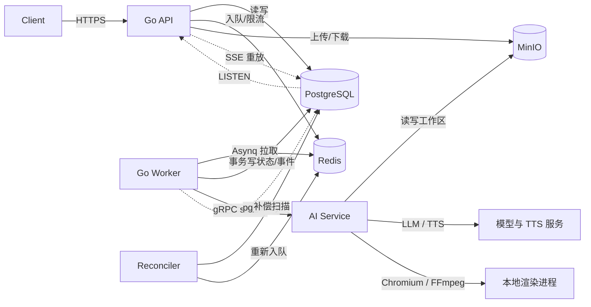
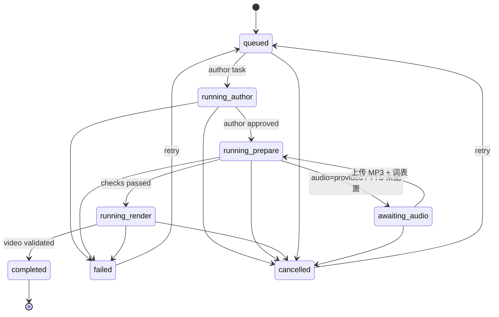

# 理象服务架构设计

状态：设计草案，2026-10-22。目标是把当前单进程 Node.js 服务演进为可横向扩展的 Go 控制面 + AI 执行面，保留已经验证过的 Pi / HyperFrames / TTS / 质量门工作流。

## 1. 结论先行

1. **AI 工作流继续使用 TypeScript**，不在 Go 中重写。`ai-service/core/` 中的作者、审核、校验、TTS、对齐、编译、渲染和成片检查整体迁入独立 AI 服务。
2. **Go 只做控制面**：HTTP API、鉴权、配额、任务编排、状态机、事件、产物元数据。Go 不包含题目、讲稿、数学或渲染逻辑。
3. **任务按阶段拆分**：`author`、`prepare`、`render` 三个阶段分别入队，避免 LLM 等待占住渲染槽，也避免渲染失败重跑付费模型。
4. **PostgreSQL 是唯一事实源**，Redis 只承担可重建的队列、限流和缓存，MinIO 保存输入、工作文件和最终产物。Redis 丢数据不能导致任务永久丢失。
5. **内部接口使用 gRPC server-streaming**：Go 调用 AI，AI 流式回传阶段、进度、产物和用量；取消通过 gRPC context 传播到 Chromium、FFmpeg 和 TTS 子进程。
6. **对外 API 保持 `/v1` 兼容**：现有创建、查询、SSE、取消、重试、音频导入和下载接口不破坏；新增直传上传接口，同时保留 base64 兼容路径。
7. **SSE 事件以 PostgreSQL 为准**：状态变更和 `pg_notify` 在同一事务提交，断线用 `Last-Event-ID` 从 PG 重放，不依赖 Redis Pub/Sub 的持久性。
8. **产物使用内容寻址缓存**：TTS、已审核源码、已验证视频按摘要复用，跨 worker、跨重试都有效，直接降低重复模型和渲染成本。

## 2. 现状与目标

### 2.1 现状

当前实现是单实例 Node.js + Express：

- 任务队列在进程内存中，状态写入 `workspaces/<id>/job.json`，事件写入 `events.jsonl`。
- 用目录锁阻止多进程共享状态目录，无法水平扩展。
- 图片和音频通过 base64 放进 JSON，最大请求体 64 MB。
- SSE 只连接当前进程，跨实例无法续读。
- 作者、审核、TTS、编译、检查、渲染、验证在同一个任务执行链中完成，渲染会占住整个任务槽。
- 渲染和 Chromium 与 API 在同一进程空间，不适合直接对公网提供不可信题目。

### 2.2 目标

- API 无状态，可多实例部署；任意实例都能提供状态查询和 SSE。
- 任务在进程崩溃、重启、扩容后不丢失；重复投递不产生重复任务或重复产物。
- LLM 阶段与渲染阶段独立扩缩容，渲染资源不浪费在模型等待上。
- 输入、工作文件、报告和视频进入对象存储，下载接口支持鉴权和 Range 请求。
- 保留现有质量门和成本复用语义：源码摘要、音频摘要、审核提示词摘要、视频摘要绑定不能弱化。
- 为配额、计费、审计和多租户留出数据模型，但首版可以只用单租户静态 API Key。

### 2.3 非目标

- 不把 Pi agent 或 HyperFrames 改写成 Go。
- 不引入 Temporal 等通用工作流引擎；当前状态机足够简单，Redis + PG 更易运维。
- 首版不暴露 MinIO 给公网，不默认使用预签名上传。
- 首版不做网页工作台、计费支付、多地域容灾。
- 不把数值检查和模型审核包装成数学形式化证明，现有质量边界不变。

## 3. 总体架构



### 3.1 组件职责

| 组件 | 职责 | 状态 |
| --- | --- | --- |
| `api` | 鉴权、参数校验、创建/查询/取消/重试、音频导入、SSE、产物下载、健康检查、OpenAPI | 无状态 |
| `worker` | 消费 Asynq 任务、调用 AI、推进状态机、写事件、处理重试/超时/取消 | 无业务状态，DB 中有租约 |
| `reconciler` | 补偿丢失的任务投递、清理过期租约、标记中断任务 | 通过 PG advisory lock 单实例运行 |
| `ai-service` | 执行 `author/prepare/render/ingest_audio`，流式上报，读写 MinIO，调用模型与渲染工具 | 无共享状态，本地 scratch |
| PostgreSQL | 任务、事件、产物元数据、运行记录、用量、账户和 Key | 唯一事实源 |
| Redis | Asynq 队列、限流计数、取消信号、短期热缓存 | 可重建 |
| MinIO | 输入图片、工作文件、报告、音频、字幕、视频、缓存 | 字节事实源 |

### 3.2 为什么 AI 工作流不迁到 Go

现有 `ai-service/core/pi.ts`、`ai-service/core/quality.ts`、`ai-service/core/compiler.ts` 依赖 Pi SDK、Playwright、HyperFrames 和 KaTeX 的 Node 生态；这些是不可替换的运行时能力。把编排搬到 Go、把执行留在 Node，边界清晰：

- Go 负责“什么时候跑、能不能跑、失败了怎么办、给谁看”。
- AI 服务负责“怎么生成、怎么检查、怎么渲染”。

Go 需要理解的领域概念只有阶段名称和产物清单，不复制作者/审核逻辑。后续 AI 工作流继续演进时，不需要同步修改 Go 状态机。

## 4. 技术选型

| 领域 | 选择 | 理由 |
| --- | --- | --- |
| HTTP | Go 1.24+、`net/http` + `chi` | 轻量，中间件生态足够，避免重框架 |
| 数据库访问 | `pgx/v5` + `sqlc` | 类型安全 SQL，事务和 `LISTEN/NOTIFY` 支持好 |
| 迁移 | `goose` | 纯 SQL 迁移，适合小团队 |
| 队列 | `hibiken/asynq` | Redis 原生 Go 队列，自带重试、延迟、超时、唯一任务、归档和监控 UI |
| 内部 RPC | gRPC + `buf` | 强类型、流式、deadline、取消传播；Go 和 TS 都能生成代码 |
| 对象存储 | MinIO，S3 兼容 | 本地和云端一致；生产可替换为 S3/OSS |
| 事件 | PostgreSQL `LISTEN/NOTIFY` + 事件表重放 | 与状态变更同事务，避免双写丢事件 |
| 鉴权 | Bearer API Key + Argon2id | 兼容现有 `SERVICE_API_KEY`，支持数据库 Key 和 scope |
| 可观测性 | OpenTelemetry + Prometheus + JSON logs | 任务链路跨 API、worker、AI |
| 对外契约 | OpenAPI 3.1 | 生成 Go 类型和 TS 类型，减少双端漂移 |

### 4.1 为什么用 Asynq 而不是手写 Redis Streams

worker 全部是 Go，AI 服务只通过 gRPC 被调用，因此不需要跨语言消费队列。Asynq 已经提供：

- 任务重试、指数退避、最大重试次数。
- 任务超时、截止时间、唯一任务 ID。
- 延迟任务、优先级队列、并发限制。
- 进程崩溃后的 active 任务回收。
- `asynqmon` 查看队列、活跃任务和归档任务。

如果未来需要 Node worker 直接消费队列，再引入 Redis Streams 或 NATS；当前不为此增加复杂度。

### 4.2 PostgreSQL、Redis、MinIO 的一致性边界

- **PG 是状态事实源**：任务状态、阶段、事件、产物摘要、运行记录都在 PG。Redis 中只有“待执行”消息，丢了可以扫描 PG 重新投递。
- **MinIO 是字节事实源**：PG 只保存 object key、大小和 SHA-256；读取时校验摘要，不信任客户端声明。
- **Redis 不保存不可恢复数据**：限流计数、锁、取消频道、短 TTL 缓存都可以丢。Asynq 本身依赖 Redis，但由 reconciler 用 PG 补偿。
- **事件不双写**：`job_events` 插入和 `pg_notify` 在一个事务内完成；SSE 网关只消费通知，断线后按事件 ID 从 PG 重放。

## 5. 仓库与进程布局

```text
reasonframe/
  backend/                       # Go 控制面
    cmd/rf/main.go               # rf api | worker | reconciler | migrate
    internal/api/                # HTTP handlers、SSE、鉴权、OpenAPI
    internal/jobs/               # 状态机、阶段推进、重试分类
    internal/queue/              # Asynq 客户端、任务定义、消费者
    internal/ai/                 # gRPC 客户端、proto 生成代码
    internal/store/              # pgx/sqlc 查询、事务
    internal/storage/            # MinIO 上传、下载、摘要校验
    internal/events/             # LISTEN/NOTIFY、SSE hub
    internal/auth/               # API Key、scope、限流
    internal/config/             # 环境变量与启动校验
    migrations/                  # SQL migrations + embedded runner
    api/openapi.yaml             # 对外契约
  ai-service/                    # Node/TypeScript AI 执行面（自包含 Node 工程）
    package.json / package-lock.json
    tsconfig.json
    src/index.ts                 # gRPC server、健康检查、优雅退出
    src/tasks/{author,prepare,render,ingest}.ts
    src/storage.ts               # MinIO <-> 本地 scratch
    src/workspace.ts
    core/                        # Pi / 校验 / 编译 / 质量代码
    shared/                      # Zod schema 与共享 fixture
    templates/ prompts/ scripts/ tests/ examples/
    docs/authoring.md
  proto/pipeline/v1/*.proto      # Go 与 TS 共用
  deploy/compose.yaml            # dev：PG、Redis、MinIO、api、worker、ai
```

`backend/cmd/rf` 是单一二进制，通过子命令启动不同进程；这样 API、worker、reconciler 共享配置、数据库和队列代码，但可以独立部署和扩缩容。

## 6. 任务模型与状态机

### 6.1 阶段任务

| 任务 | Asynq 队列 | 主要动作 | 产物/检查点 | 默认超时 | 自动重试策略 |
| --- | --- | --- | --- | --- | --- |
| `author` | `author` | 答案 agent、结构/公式/数值校验、独立答案审核、内容返修 | `answer_sha256`、`source_sha256`、`script_sha256`、answer/answer_review/narration | 20 min | AI 启动前基础设施错误最多 2 次；启动后不自动重跑 |
| `prepare` | `prepare` | TTS 或等待导入音频、视频 agent + 独立视频审核、重对齐、编译、浏览器/HyperFrames 检查 | `source_sha256`、`timeline_sha256`、视频源码/审核、音频/词表、检查报告 | 15 min | 基础设施错误最多 2 次；视觉失败可按预算返修 |
| `render` | `render` | 渲染、转码、成片验证、质量报告 | `video_sha256`、video/quality | 45 min | 渲染/上传瞬时错误最多 1 次；验证失败不自动重跑 |
| `ingest_audio` | `prepare` | 校验上传 MP3 与词表、写入工作区、标记可继续 | `audio_sha256`、`words_sha256` | 5 min | 不自动重试，失败返回用户可修复错误 |

拆成三个阶段的原因：

- `author` 是网络和 token 密集型，可部署较多副本；`render` 是 CPU/内存密集型，必须单独限流。
- 渲染失败不应重跑作者和审核；讲稿返修也不应占用渲染并发。
- 每个阶段都有摘要检查点，失败重试可以从阶段边界继续。
- `awaiting_audio` 只结束 `prepare` 任务，不占用 worker；上传完成后重新投递 `prepare`。

阶段内部逻辑：`author` 内答案作者 + 每轮全新上下文的答案审核自动返修；`prepare` 内 TTS/对齐、视频作者 + 每轮全新上下文的视频审核、真实预览检查、编译；`render` 内的缓存复用/渲染/验证。作者会话在各自循环的返修轮次之间保留。

### 6.2 状态机

对外状态保持现有集合：`queued`、`running`、`awaiting_audio`、`completed`、`failed`、`cancelled`。内部增加 `phase`：`author`、`prepare`、`render`、`done`。下图中的 `running_author` 等是概念态，实际 `status` 始终为 `running`，通过 `stage` 和 `phase` 区分。



补充规则：

- 阶段之间状态保持 `running`，只更新 `stage`；不把阶段切换暴露成 `queued`。
- `prepare` 发现视觉或 HyperFrames 失败且 `auto_repairs < max` 时，写 `repair.queued` 事件，回到 `author`，带上失败报告引用。
- `render` 的缓存命中直接进入 `validating`，完成后仍写完整质量门记录。
- `retry` 根据已有检查点选择恢复阶段：审核有效则从 `prepare` 或 `render` 继续，否则从 `author` 重来。
- 同一任务同一阶段只允许一个活跃 run；状态推进使用 `UPDATE ... WHERE status = 'queued' AND version = $n` 的条件更新。

### 6.3 任务 ID 与幂等

Asynq 任务 ID 使用确定性字符串：

```text
{job_id}:{phase}:{job_attempt}:{auto_repairs}
```

- `job_attempt` 是用户显式重试次数，`auto_repairs` 是视觉返修次数。
- 同一阶段重复投递会因任务 ID 相同被 Asynq 去重；任务完成后若因崩溃再次投递，handler 先做状态 CAS，发现阶段已推进就直接 ack。
- AI 阶段本身也幂等：已存在且摘要匹配的已审核源码、音频、时间线和已验证视频会跳过对应昂贵步骤。
- 任务 payload 只放 `job_id`、`phase`、`attempt`、`auto_repairs`、`traceparent`；题目、图片、密钥和报告都不进队列。

### 6.4 取消

1. `POST /v1/jobs/:id/cancel` 在 PG 事务中把任务置为 `cancelled`，写 `cancelled` 事件。
2. 删除 Asynq 中尚未执行的同任务；通过 Redis 频道 `rf:cancel:{job_id}` 通知正在执行的 worker。
3. worker 取消 gRPC context；AI 服务把取消映射为 `AbortSignal`，终止 LLM 请求、TTS、Chromium 和 FFmpeg 进程组。
4. 终态后 AI 迟到的进度事件被 worker 丢弃，不能把任务写回 `running`。
5. Redis 通知丢失时，worker 在每次事件处理和阶段结束时检查 PG 状态，仍然能停止。

### 6.5 重试与失败分类

| 错误类型 | 例子 | 处理 |
| --- | --- | --- |
| 瞬时基础设施 | Redis/MinIO 连接失败、gRPC 不可用、429/5xx | Asynq 退避重试；阶段未开始时安全 |
| 模型瞬时错误 | 限流、超时、网络中断 | 在 AI 服务内部按现有 `LLM_MAX_ATTEMPTS` 重试；不把整个阶段交给 Asynq 重跑 |
| 内容失败 | 审核拒绝、数值断言失败、agent 预算耗尽 | 任务 `failed`，保留报告，等待用户显式 retry |
| 视觉可返修 | `VISUAL_CHECK_FAILED`、`HYPERFRAMES_CHECK_FAILED` | 在 `auto_repairs` 预算内回到 `author` |
| 成片失败 | 编码错误、SSIM 不达标、音轨缺失 | 先重试 `render` 一次（可复用缓存）；仍失败则任务失败 |
| 服务停止 | SIGTERM、pod 驱逐、worker 崩溃 | 标记 `INTERRUPTED` 并失败，要求显式 retry，避免自动重复付费调用 |

任务 `attempt` 与 Asynq 重试次数分开：`attempt` 面向用户可见的任务重试；Asynq 重试只处理传输和调度层问题，并记录在 `job_runs`。

### 6.6 崩溃恢复

- Asynq 会回收租约过期的 active 任务；worker 启动时也可能收到旧任务。
- handler 开始时读取 `job_runs`：若同一任务已有 `running` 且心跳过期，说明上次执行中断。按当前产品策略把任务标记为 `failed/INTERRUPTED`，不自动续跑付费步骤。
- 用户 retry 后，AI 服务从 MinIO 恢复检查点；已审核源码仍有效时直接进入 `prepare`，不重复作者和审核。
- `reconciler` 每 30 秒扫描 PG：
  - `queued` 超过阈值且没有活跃任务：重新入队。
  - `running` 但租约过期：标记 `INTERRUPTED`，写事件。
  - 清理过期 upload 记录和临时对象。
- reconciler 用 `pg_try_advisory_lock` 保证同一时刻只有一个实例执行补偿。

## 7. 数据模型

核心表如下，实际迁移放在 `backend/migrations/`。所有时间使用 `timestamptz`，ID 使用 UUIDv7（由应用生成，兼顾索引局部性）。

```sql
CREATE TYPE job_status AS ENUM ('queued', 'running', 'awaiting_audio', 'completed', 'failed', 'cancelled');
CREATE TYPE job_phase AS ENUM ('author', 'prepare', 'render', 'done');
CREATE TYPE artifact_state AS ENUM ('pending', 'ready', 'rejected');

CREATE TABLE accounts (
  id uuid PRIMARY KEY,
  slug text NOT NULL UNIQUE,
  name text NOT NULL,
  created_at timestamptz NOT NULL DEFAULT now()
);

CREATE TABLE api_keys (
  id uuid PRIMARY KEY,
  account_id uuid NOT NULL REFERENCES accounts(id),
  name text NOT NULL,
  key_prefix text NOT NULL UNIQUE,
  key_hash bytea NOT NULL,
  scopes text[] NOT NULL DEFAULT '{}',
  expires_at timestamptz,
  revoked_at timestamptz,
  last_used_at timestamptz,
  created_at timestamptz NOT NULL DEFAULT now()
);

CREATE TABLE jobs (
  id uuid PRIMARY KEY,
  account_id uuid NOT NULL REFERENCES accounts(id),
  status job_status NOT NULL DEFAULT 'queued',
  phase job_phase NOT NULL DEFAULT 'author',
  stage text NOT NULL DEFAULT 'queued',
  priority smallint NOT NULL DEFAULT 0,
  input jsonb NOT NULL,
  options jsonb NOT NULL,
  checkpoint jsonb NOT NULL DEFAULT '{}'::jsonb,
  idempotency_key text,
  request_sha256 text,
  attempt int NOT NULL DEFAULT 0,
  auto_repairs int NOT NULL DEFAULT 0,
  max_auto_repairs int NOT NULL DEFAULT 1,
  source_sha256 text,
  script_sha256 text,
  error_code text,
  error_message text,
  active_task_id text,
  lease_expires_at timestamptz,
  version bigint NOT NULL DEFAULT 0,
  created_at timestamptz NOT NULL DEFAULT now(),
  updated_at timestamptz NOT NULL DEFAULT now(),
  started_at timestamptz,
  finished_at timestamptz
);

CREATE UNIQUE INDEX jobs_idempotency_uq
  ON jobs(account_id, idempotency_key)
  WHERE idempotency_key IS NOT NULL;
CREATE INDEX jobs_account_created_idx ON jobs(account_id, created_at DESC, id);
CREATE INDEX jobs_status_updated_idx ON jobs(status, updated_at);
CREATE INDEX jobs_lease_idx ON jobs(lease_expires_at) WHERE status = 'running';

CREATE TABLE job_runs (
  id uuid PRIMARY KEY,
  job_id uuid NOT NULL REFERENCES jobs(id) ON DELETE CASCADE,
  phase job_phase NOT NULL,
  task_id text NOT NULL,
  run_attempt int NOT NULL DEFAULT 0,
  worker_id text NOT NULL,
  status text NOT NULL,
  error_code text,
  started_at timestamptz NOT NULL DEFAULT now(),
  heartbeat_at timestamptz NOT NULL DEFAULT now(),
  finished_at timestamptz,
  UNIQUE (task_id, run_attempt)
);
CREATE INDEX job_runs_job_idx ON job_runs(job_id, started_at DESC);

CREATE TABLE job_events (
  id bigserial PRIMARY KEY,
  job_id uuid NOT NULL REFERENCES jobs(id) ON DELETE CASCADE,
  type text NOT NULL,
  stage text,
  task_id text,
  data jsonb NOT NULL DEFAULT '{}'::jsonb,
  created_at timestamptz NOT NULL DEFAULT now()
);
CREATE INDEX job_events_job_idx ON job_events(job_id, id);
CREATE INDEX job_events_created_idx ON job_events(created_at);

CREATE TABLE artifacts (
  id uuid PRIMARY KEY,
  job_id uuid NOT NULL REFERENCES jobs(id) ON DELETE CASCADE,
  name text NOT NULL,
  version int NOT NULL DEFAULT 1,
  object_key text NOT NULL,
  mime_type text NOT NULL,
  size_bytes bigint NOT NULL,
  sha256 text NOT NULL,
  state artifact_state NOT NULL DEFAULT 'ready',
  is_current boolean NOT NULL DEFAULT true,
  source_sha256 text,
  created_at timestamptz NOT NULL DEFAULT now(),
  UNIQUE (job_id, name, version)
);
CREATE UNIQUE INDEX artifacts_current_uq ON artifacts(job_id, name) WHERE is_current;

CREATE TABLE uploads (
  id uuid PRIMARY KEY,
  account_id uuid NOT NULL REFERENCES accounts(id),
  job_id uuid REFERENCES jobs(id) ON DELETE CASCADE,
  kind text NOT NULL,
  object_key text NOT NULL UNIQUE,
  mime_type text,
  size_bytes bigint,
  sha256 text,
  state text NOT NULL DEFAULT 'pending',
  expires_at timestamptz NOT NULL,
  created_at timestamptz NOT NULL DEFAULT now()
);

CREATE TABLE usage_records (
  id bigserial PRIMARY KEY,
  job_id uuid NOT NULL REFERENCES jobs(id) ON DELETE CASCADE,
  phase job_phase NOT NULL,
  provider text NOT NULL,
  model text,
  input_tokens bigint NOT NULL DEFAULT 0,
  output_tokens bigint NOT NULL DEFAULT 0,
  audio_chars bigint NOT NULL DEFAULT 0,
  render_seconds numeric(12, 3) NOT NULL DEFAULT 0,
  cost_micros bigint NOT NULL DEFAULT 0,
  metadata jsonb NOT NULL DEFAULT '{}'::jsonb,
  created_at timestamptz NOT NULL DEFAULT now()
);
```

### 7.1 设计说明

- `input` 保存规范化后的题目、范围、补充和图片对象引用；原始 API 请求不落库，避免 base64 膨胀。
- `jobs.version` 用于 CAS；任何状态推进都递增版本，避免两个 worker 同时推进。
- `job_runs` 记录每次实际执行，便于回答“谁在跑、跑了多久、为什么中断”，也用于 reconciler 判断租约。
- `job_events.id` 是全局自增，SSE 的 `id:` 直接使用它；客户端只需单调递增，不依赖每个任务从 1 开始。
- `artifacts.is_current` 保证同一逻辑产物只有一个当前版本，同时保留历史版本供审计。
- `usage_records` 先记录，再聚合到账户账单；不把计费放进任务事务，避免计费故障阻塞生成。
- `job_events` 首版不分区；当单表超过约 5000 万行后按 `created_at` 月分区，查询必须带 `job_id` 和起始时间。

### 7.2 从现有文件状态迁移

提供一次性工具 `rf migrate-fs --root workspaces`：

- 读取 `job.json`、`events.jsonl` 和产物文件，写入 PG/MinIO。
- 用原任务 ID 保持幂等；已存在的任务跳过。
- 事件 ID 重新分配，保留原类型、时间和数据；客户端续读以新 ID 为准。
- 迁移完成后保留原目录只读一段时间，不立即删除。

## 8. 对象存储设计

### 8.1 Bucket 与目录

每个环境一个 bucket，例如 `reasonframe-prod`，保持私有，不直接暴露公网。

```text
jobs/{job_id}/input/request.json
jobs/{job_id}/input/problem-1.png
jobs/{job_id}/work/lesson.json
jobs/{job_id}/work/visual.js
jobs/{job_id}/work/style.css
jobs/{job_id}/work/narration.txt
jobs/{job_id}/work/words.json
jobs/{job_id}/work/timeline.json
jobs/{job_id}/work/reports/*.json
jobs/{job_id}/artifacts/{version}/{name}
jobs/{job_id}/logs/attempt-{n}.log
cache/tts/{cache_key}.mp3
cache/tts/{cache_key}.words.json
cache/render/{cache_key}.mp4
cache/render/{cache_key}.quality.json
```

- `input/` 是不可变输入；创建任务后不允许覆盖。
- `work/` 是阶段检查点，允许覆盖，但每次对象上传带 SHA-256 元数据。
- `artifacts/` 是公开 API 可下载的逻辑产物，按版本保留。
- `cache/` 是内容寻址缓存，生命周期独立于单个任务。
- 临时 `pending.mp4` 先上传到 `work/` 或缓存，验证通过后才写 `artifacts/video` 元数据。

### 8.2 缓存键

```text
tts_cache_key = sha256("tts:v1|{provider}|{voice}|{script_sha256}|{settings_sha256}")
render_cache_key = sha256("render:v1|{source_sha256}|{timeline_sha256}|{fps}|{quality}|{bitrate}|{compiler_version}|{hyperframes_version}")
```

- AI 生成前先 `HEAD` 缓存对象；命中则直接复用，并照常跑质量门验证绑定关系。
- 缓存对象带 `x-amz-meta-sha256`，读取后复核，不能只信 key。
- 源码、审核提示词、编译器或渲染器版本变化会自然改变 key，避免错误复用。

### 8.3 上传与下载

首版由 Go 代理上传下载，MinIO 保持内网：

- `POST /v1/uploads`：`multipart/form-data` 或原始字节 + `Content-Type`，Go 流式写入 MinIO，计算 SHA-256，返回 `{id, kind, mimeType, sizeBytes, sha256}`。
- `POST /v1/jobs`：`images` 支持 `{uploadId}`，同时保留 `{mimeType, base64}` 兼容旧客户端。
- `POST /v1/jobs/:id/audio`：支持 `{audioUploadId, wordsUploadId}`，同时保留 base64 兼容路径。
- `GET /v1/jobs/:id/artifacts/:name`：Go 从 MinIO 流式读取，支持 `HEAD`、`Range`、`Content-Disposition: attachment` 和 `X-Content-Type-Options: nosniff`；校验归属和 `artifact.state=ready`。
- 大文件或 CDN 场景可增加 `?redirect=1` 返回短时效预签名 URL；此时才需要配置 MinIO 的公网端点和 TLS。
- 下载 URL 不暴露真实 object key；客户端只看到任务 ID 和逻辑产物名。

### 8.4 生命周期与保留

| 前缀 | 默认保留 | 说明 |
| --- | --- | --- |
| `jobs/*/input/` | 与任务同周期 | 题目图片属于用户数据 |
| `jobs/*/work/` | 30 天 | 支持重试和审计，过期后只保留报告和最终产物 |
| `jobs/*/artifacts/` | 90 天 | 可按账户套餐配置 |
| `jobs/*/logs/` | 30 天 | 渲染/检查日志 |
| `cache/tts/` | 90 天 | 命中率取决于讲稿复用 |
| `cache/render/` | 30 天 | 视频较大，按容量淘汰 |

删除任务时先软删 PG 记录，再由后台清理 MinIO 对象；避免事务中跨系统删除。MinIO 开启版本化和服务端加密，生产可替换为带 KMS 的 S3。

## 9. 对外 API

### 9.1 接口清单

保持现有接口语义，新增上传接口：

| 方法与路径 | 用途 | 变化 |
| --- | --- | --- |
| `GET /health` | 存活和模型是否配置 | 保持；返回 `ok`、`modelConfigured` |
| `GET /health/ready` | PG、Redis、MinIO、AI gRPC 就绪 | 新增 |
| `GET /openapi.json` | OpenAPI 3.1 | 保持 |
| `GET /v1/config` | 脱敏配置 | 保持，密钥永不返回 |
| `POST /v1/jobs` | 创建任务 | 支持 `Idempotency-Key` 和 `uploadId` |
| `GET /v1/jobs` | 最近任务 | 增加 `cursor`/`limit`，默认 100 |
| `GET /v1/jobs/:id` | 状态、阶段、错误、产物 | 保持 |
| `GET /v1/jobs/:id/events` | SSE，支持 `Last-Event-ID` 或 `?after=` | 保持，跨实例可用 |
| `GET /v1/jobs/:id/narration` | 讲稿与 SHA-256 | 从 MinIO 读取 |
| `POST /v1/jobs/:id/audio` | 导入 MP3 + 词表 | 支持 uploadId |
| `POST /v1/jobs/:id/cancel` | 取消 | 保持 |
| `POST /v1/jobs/:id/retry` | 重试失败/取消任务 | 保持，自动选择恢复阶段 |
| `GET /v1/jobs/:id/artifacts/:name` | 下载产物 | Go 代理 MinIO，支持 Range |
| `POST /v1/uploads` | 上传图片/音频/词表 | 新增 |

错误格式保持：

```json
{"error": {"code": "INVALID_STATE", "message": "Audio can only be supplied while awaiting_audio"}}
```

新增错误码：`RATE_LIMITED`、`QUOTA_EXCEEDED`、`IDEMPOTENCY_CONFLICT`、`UPLOAD_INVALID`、`SERVICE_UNAVAILABLE`。状态码映射：400/422 输入，401 未认证，403 越权，404 不存在，409 状态冲突，413 过大，429 限流/配额，503 依赖不可用。

### 9.2 创建任务流程

1. 鉴权并解析 API Key 的账户和 scope。
2. 校验 `Idempotency-Key`；同账户同 key 且请求摘要相同，直接返回已有任务。
3. 校验输入：题目长度、图片数量/大小/类型、音频选项、fps、quality、template。
4. 把内联图片写入 MinIO；校验 `uploadId` 归属、状态和摘要。
5. 在 PG 插入任务（`queued/author`）和 `created` 事件，同一事务 `pg_notify`。
6. 提交后投递 `author` 任务；投递失败不报错，由 reconciler 补偿。
7. 返回 `202 Accepted` 和 `Location: /v1/jobs/{id}`。

### 9.3 SSE 事件

- 事件 ID 使用 `job_events.id`，客户端用 `Last-Event-ID` 或 `?after=` 续读。
- 连接流程：先订阅本实例的本地 hub，再从 PG 查询 `id > after` 的事件重放，最后切换到实时通知；用 ID 去重，避免重放和通知之间的竞态。
- 心跳每 15 秒发送 `: heartbeat`，禁用代理缓冲，设置 `Cache-Control: no-cache`。
- 若 `LISTEN` 连接断开，hub 重连后通知所有连接从 PG 补读。
- 单条 `NOTIFY` 超过约 7 KB 时只发送事件 ID，SSE 层再按 ID 取行，避免 PostgreSQL 通知负载上限。
- 事件类型保留现有命名：`created`、`started`、`stage`、`source.approved`、`agent.*`、`awaiting_audio`、`audio.accepted`、`repair.queued`、`completed`、`failed`、`cancelled`、`retried`、`interrupted`，新增 `task.started`、`artifact.ready`、`usage.recorded`。

### 9.4 鉴权与限流

- 兼容模式：`AUTH_MODE=static`，使用 `SERVICE_API_KEY` 常量时间比较，行为与现在一致。
- 数据库模式：API Key 格式 `rf_live_<key_id>_<secret>`，数据库存 `key_prefix` 和 Argon2id 哈希；校验 scope。
- 所有任务查询和产物下载都带 `account_id` 条件，防止跨账户访问。
- Redis 滑动窗口限流：创建任务、上传、下载分别限流；超限返回 429 和 `Retry-After`。
- 每账户同时活跃任务数默认 2、排队数默认 10；超额返回 429。管理员可配置。
- 浏览器或前端无法设置 Authorization 时，使用 `fetch` 流式读取 SSE；不让 token 出现在查询字符串和访问日志中。

### 9.5 契约管理

- `backend/api/openapi.yaml` 是公开接口唯一契约，使用 `oapi-codegen` 生成 Go 类型和 server 骨架。
- 用 `openapi-typescript` 生成 TS 类型给 AI 服务和测试使用。
- `ai-service/shared/schema.ts` 中的 Zod 继续作为 AI 边界运行时校验；CI 用同一组 fixture 验证 OpenAPI、Go 校验和 Zod 结果一致。
- 版本策略：不破坏 `/v1`；新增字段可选；删除字段或改变语义走 `/v2`。

## 10. AI 服务内部契约

### 10.1 gRPC 服务

```proto
syntax = "proto3";
package reasonframe.pipeline.v1;

service PipelineService {
  rpc RunTask(RunTaskRequest) returns (stream TaskEvent);
  rpc Cancel(CancelRequest) returns (CancelResponse);
  rpc Health(HealthRequest) returns (HealthResponse);
}

enum TaskType {
  TASK_TYPE_UNSPECIFIED = 0;
  AUTHOR = 1;
  PREPARE = 2;
  RENDER = 3;
  INGEST_AUDIO = 4;
}

message RunTaskRequest {
  string task_id = 1;
  string job_id = 2;
  TaskType type = 3;
  int32 attempt = 4;
  int32 auto_repairs = 5;
  bytes spec_json = 6;
  bytes checkpoint_json = 7;
  bytes trace_json = 8;
  int64 deadline_unix_ms = 9;
}

message TaskEvent {
  int64 seq = 1;
  string type = 2;
  string stage = 3;
  bytes data_json = 4;
  int64 at_unix_ms = 5;
  TaskResult result = 6;
}

message TaskResult {
  string status = 1;
  string error_code = 2;
  string error_message = 3;
  bool repairable = 4;
  bytes checkpoint_json = 5;
  repeated ArtifactRef artifacts = 6;
  Usage usage = 7;
}

message ArtifactRef {
  string name = 1;
  string object_key = 2;
  string mime_type = 3;
  int64 size_bytes = 4;
  string sha256 = 5;
}

message Usage {
  string provider = 1;
  string model = 2;
  int64 input_tokens = 3;
  int64 output_tokens = 4;
  int64 audio_chars = 5;
  double render_seconds = 6;
  int64 cost_micros = 7;
}
```

说明：

- `spec_json` 是规范化任务输入的 JSON，包含题目、范围、补充、选项、图片对象引用；不包含密钥。
- `checkpoint_json` 包含 `source_sha256`、`script_sha256`、`audio_sha256`、`timeline_sha256`、`stage`、`artifacts` 等；由 AI 生成、Go 原样保存。
- `trace_json` 传 W3C `traceparent` 和 `tracestate`，便于跨语言链路。
- 流结束前发送一个 `type=result` 的事件，`TaskEvent.result` 包含 `TaskResult`；业务失败用 `status=failed`，gRPC error 只表示传输或内部崩溃。
- `deadline_unix_ms` 由 Go 设置，AI 内部再按阶段预算收紧；超时后 AI 必须终止子进程再返回。

### 10.2 阶段语义

**author**

- 输入：题目、图片、scope、supplements、template、已有检查点/返修报告。
- 执行：答案 agent 写 `answer.json`（答案、claims、model、solution、整篇旁白）；结构/公式/数值校验；独立答案审核；内容返修。答案作者会话跨审核轮次保留，每次审核使用全新只读会话。
- 成功：答案通过审核，产出 `answer_sha256`、`source_sha256`（AUTHOR 阶段等于答案摘要）、`script_sha256`、讲稿和答案审核报告。此时还没有 `lesson.json`。
- 失败：`REVIEW_REJECTED`、`AGENT_BUDGET`、`MODEL_UNAVAILABLE`；只有网络类错误可重试。
- 幂等：若已有答案审核有效且答案/讲稿摘要一致，直接返回检查点，不调用模型；但 `repair` 模式必须重新走答案作者和审核，不能复用旧批准。

**prepare**

- 输入：已审核源码、音频模式、已有音频上传。
- 执行：
  - `audio=auto` 且配置 TTS：以已批准旁白整篇合成，写 TTS 缓存。
  - `audio=provided` 或未配置 TTS：返回 `awaiting_audio`，不失败。
  - 视频 agent 读取已批准答案，生成 `lesson.json`、`src/visual.js`、`src/style.css`；不能改写答案或旁白。
  - 按最终 lesson 重对齐已有音频、编译、真实浏览器检查，视频审核者每轮用全新上下文查看实际预览帧。
  - 视频审核通过后，再做最终对齐、编译、浏览器与 HyperFrames 检查。
- 成功：最终 `source_sha256`、`timeline_sha256`、视频源码/审核、检查报告、可渲染清单。
- 失败：`VISUAL_CHECK_FAILED`/`HYPERFRAMES_CHECK_FAILED`/`VIDEO_QUALITY_GATE_FAILED` 标记 `repairable=true`；答案本身问题标记 `ANSWER_REVISION_REQUIRED` 并回到 author。
- 幂等：答案/音频/时间线/视频源码摘要匹配时复用；已批准的视频源码不重新调用视频 agent 或 reviewer；编译产物确定性重建，不长期保存整个 render 目录。

**render**

- 输入：可渲染清单、fps、quality、来源摘要。
- 执行：查渲染缓存；否则从 lesson + timeline 确定性重编译，校验 `build_sha256` 与 `prepare` 检查过的清单一致，再渲染、转码、成片验证，上传视频和质量报告。
- 成功：`video_sha256`、`quality.json`，视频 artifact 置为 `ready`。
- 失败：`VIDEO_CHECK_FAILED` 可同阶段重试一次；编码/环境错误按基础设施重试；仍失败则任务失败。
- 幂等：缓存命中直接返回；验证报告绑定视频 SHA、源码 SHA、时间线 SHA 和检查器版本。

**ingest_audio**

- 输入：MP3 和词表的对象引用。
- 执行：校验 MP3 完整性、词表覆盖、时间顺序、脚本摘要绑定；写入工作区。
- 成功：任务回到 `queued/prepare`，投递 `prepare`。
- 失败：`INVALID_AUDIO`、`WORD_TABLE_INVALID`，任务保持 `awaiting_audio` 并返回可修复错误。

### 10.3 AI 服务工作区

AI 服务不共享本地磁盘：

```text
/scratch/{job_id}/{task_id}/
  input/          # 从 MinIO 拉取
  work/           # 阶段文件
  render/         # 编译输出，任务结束删除
  reports/        # 检查报告
```

- 任务开始：按检查点从 MinIO 拉取所需对象，校验 SHA-256。
- 任务结束：上传检查点和产物，写 artifact 清单；清理 scratch。
- 失败：尽力上传已有检查点，便于用户 retry 复用；上传失败不掩盖原始错误。
- 磁盘配额：单任务默认 4 GB，超过直接失败；Chromium/FFmpeg 临时目录也在 quota 内。
- 现有 `ai-service/core/*` 的 fs 接口保持不变，通过 workspace 适配器同步；这样阶段拆分不需要重写编译、检查和渲染代码。

### 10.4 健康检查

AI 服务 `Health` 返回：

- `modelConfigured`：LLM 四项配置齐全。
- `ttsConfigured`：TTS provider 可用。
- `ffmpeg`、`ffprobe`、`chromium` 可执行。
- `minioReachable`。
- `activeTasks`、`maxTasks`、`capabilities`。

Go 的 `/health/ready` 检查 PG、Redis、MinIO 和对应阶段的 AI 地址；`/health` 只检查进程存活和模型配置，避免依赖抖动导致重启风暴。

## 11. 队列、事件与一致性

### 11.1 Asynq 配置

- 队列：`author`、`prepare`、`render`。
- 独立 worker 进程按队列启动，分别设置并发：
  - `author`：网络型，可 2–4 并发/副本。
  - `prepare`：Chromium/TTS，1–2 并发/副本。
  - `render`：CPU 密集型，1 并发/副本，独立节点池。
- 每个任务设置 `asynq.Timeout` 和 `asynq.Deadline`；AI 内部超时应略小于 Asynq 超时，保证能优雅终止。
- 归档任务保留 7 天，`asynqmon` 提供人工查看；归档队列非空触发告警。
- 任务失败重试由自定义 `RetryDelayFunc` 控制：基础设施错误指数退避；领域错误直接 `SkipRetry` 并写失败事件。

### 11.2 事件写入

handler 每收到一个 AI 事件：

1. `INSERT INTO job_events (...) RETURNING id`。
2. 需要更新阶段时，条件更新 `jobs`（`WHERE id=$1 AND status='running' AND version=$2`）。
3. 同一事务执行 `SELECT pg_notify('job_events', $payload)`。
4. 提交；API 实例的 `LISTEN` 连接收到通知，fan-out 给本地 SSE 连接。`LISTEN` 使用专用连接，不经过 `pgxpool`。

频率控制：

- `progress` 事件最多每 2 秒落库一次；AI 可以更频繁地上报，Go 合并。
- `agent.*` 事件数量有限，按原样保存。
- 大报告只保存对象 key、摘要和摘要统计，完整内容在 MinIO；避免事件表膨胀。
- 日志不写 PG，写 stdout/文件并由日志系统收集；任务目录保留 `render.log` 到 MinIO。

### 11.3 状态推进事务

阶段完成时，在同一个 PG 事务中：

```text
UPDATE jobs SET phase=..., status=..., source_sha256=..., script_sha256=...,
                active_task_id=NULL, lease_expires_at=NULL, version=version+1,
                updated_at=now()
WHERE id=$1 AND version=$2 AND status='running';

INSERT INTO job_events (...);
SELECT pg_notify('job_events', ...);
```

提交成功后才向 Asynq 投递下一阶段任务。若投递失败，reconciler 会发现 `queued` 任务没有活跃 task 并补投；因此不需要跨 PG/Redis 的分布式事务。

### 11.4 Redis 故障与重建

- Redis 使用 AOF `everysec`，生产配置副本或 Sentinel；但即使全丢，PG 仍保留任务终态和检查点。
- reconciler 定期对比 PG 与 Asynq：
  - `queued` 且 `updated_at` 超过 60 秒、没有活跃任务：重新投递。
  - `running` 且 `lease_expires_at` 过期：标记 `INTERRUPTED`。
- 限流计数丢失只会短暂放宽限制，不影响正确性。
- 取消通知丢失由 PG 状态兜底。

## 12. 并发、容量与调度

### 12.1 并发模型

- API 水平扩展，任意实例可处理任意请求和 SSE。
- worker 按队列独立扩展；同一任务同一时刻只允许一个活跃 run，靠 PG CAS 和 Asynq 任务 ID 双重保护。
- render 并发由 worker 副本数与 `RENDER_WORKERS` 共同决定；AI 服务自身也有并发信号量，超限返回 `RESOURCE_EXHAUSTED`，worker 延迟重试，避免压垮机器。
- 每账户并发和排队上限在创建时检查；全局队列深度通过 Asynq 指标监控。

### 12.2 优先级与公平性

- `jobs.priority` 预留给付费/管理员任务；首版可按优先级拆成 `author:high`、`author:default` 队列，worker 按权重消费。
- 先保证每账户公平：同一账户不能占满全局队列；Redis 计数器 `rf:acct:{id}:active` 限制活跃任务。
- 渲染任务不因低优先级作者任务饿死；作者任务也不因长渲染阻塞。

### 12.3 扩缩容

- API：按 CPU、QPS、SSE 连接数扩缩。
- author/prepare：按 Asynq 队列深度扩缩；用 Prometheus exporter 暴露队列长度给 KEDA。
- render：按渲染队列深度和节点 CPU/内存扩缩，优先使用独立节点池。
- PG/Redis/MinIO：首版单实例或托管服务；MinIO 生产建议分布式模式或替换为云对象存储。

### 12.4 容量估算

单任务典型产物：视频约 20–50 MB，报告和源码小于 5 MB，音频数 MB；工作文件与缓存另计。按每天 100 个任务、保留 90 天估算，对象存储约 0.5–1.5 TB，需按实际码率和重试次数留余量。

## 13. 安全

### 13.1 不可信内容隔离

AI 服务会执行模型生成的 JavaScript/CSS 并启动 Chromium，必须按不可信代码处理：

- 独立容器、非 root、只读根文件系统、`/scratch` 使用有大小限制的临时卷。
- 丢弃 capabilities，启用 `seccomp=RuntimeDefault`，禁止 privileged 和 hostPath。
- NetworkPolicy：只允许访问 MinIO、LLM、TTS 和 DNS；禁止访问云元数据、内网管理面和任意公网地址。
- 浏览器继续使用现有 CSP、本地资源和 `connect-src 'none'`；禁止下载和外部导航。
- 限制 CPU、内存、PID、磁盘和单任务时长；超限终止进程组。
- 生成产物只通过下载接口以附件形式返回，不在服务域内内联渲染。

### 13.2 密钥与配置

- LLM/TTS/MinIO 密钥只放环境变量或 Secret Manager，不写 PG、不写任务输入、不返回 API。
- API Key 只存 Argon2id 哈希和前缀；日志、事件、错误消息统一脱敏 `Bearer` 和已知密钥。
- 生产使用 TLS；内部 gRPC 可加 mTLS 或至少网络策略 + 共享 token。
- 配置启动时校验，非法范围拒绝启动；`GET /v1/config` 只返回脱敏后的生效值。

### 13.3 API 与数据

- 所有对象访问校验账户归属和 artifact 状态；object key 不接受客户端输入。
- 上传校验 MIME、magic bytes、大小和 SHA-256；图片最多 4 张、每张 8 MB，音频按现有上限。
- 防止路径穿越：对象 key 由服务端生成，文件名只用于 `Content-Disposition`。
- 限流、配额、审计日志：创建、取消、重试、下载都记录 account、key、job、IP、UA。
- 数据保留和删除：用户可请求删除任务；PG 软删后由清理任务删除 MinIO 对象和缓存引用。

## 14. 可观测性与成本

### 14.1 链路与指标

- OpenTelemetry：API -> Asynq payload -> worker -> gRPC metadata -> AI；span 属性包含 `job_id`、`phase`、`task_id`、`attempt`。
- 指标：
  - `rf_jobs_created_total{subject}`
  - `rf_job_phase_duration_seconds{phase,result}`
  - `rf_queue_depth{queue}`
  - `rf_task_retries_total{phase,reason}`
  - `rf_llm_tokens_total{provider,model,kind}`
  - `rf_tts_chars_total{provider,voice}`
  - `rf_render_seconds_total{quality}`
  - `rf_artifact_bytes{kind}`
  - `rf_sse_connections`
  - `rf_dlq_depth`
- 日志：JSON 到 stdout，字段 `service`、`level`、`job_id`、`task_id`、`trace_id`、`phase`、`duration_ms`、`error_code`。
- 告警：队列持续积压、归档任务非空、AI 不可用、PG/Redis/MinIO 错误率、渲染超时率、LLM 429 比例、SSE 重放失败。

### 14.2 成本控制

- 每次任务记录 token、TTS 字符数、渲染秒数；按账户聚合。
- 任务级预算：最大模型轮数、工具次数、总时限、自动返修次数沿用现有配置；新增最大 token/金额上限，超限任务失败。
- 账户级月配额：创建任务前检查；超限返回 429，不进入队列。
- 缓存优先：审核有效源码、TTS 音频、已验证视频复用，减少重复付费调用和渲染。
- 低优先级任务可被更高优先级任务插队；渲染缓存命中不计渲染时长。

## 15. 部署与配置

### 15.1 开发环境

`deploy/compose.yaml` 启动：

```text
postgres:17
redis:7 (appendonly yes)
minio
minio-init   # 创建 bucket
rf api
rf worker --queues author,prepare
rf worker --queues render
ai-service   # 一个容器承载全部阶段，便于开发
```

API 默认监听 `127.0.0.1:4310`，保持现有习惯；AI gRPC 监听内网端口。数据库迁移通过 `rf migrate` 或 init container 执行。

### 15.2 生产环境

- API Deployment 2+ 副本，Ingress 终止 TLS，SSE 关闭代理缓冲并设置长超时。
- author/prepare/render 分开 Deployment，各自 HPA/KEDA；render 使用独立节点池（CPU 优化，内存充足）。
- PG 使用托管实例或主备 + PITR；Redis 使用主备/Sentinel + AOF；MinIO 分布式或云对象存储。
- `ai-service` 按能力拆成 `ai-author`、`ai-prepare`、`ai-render` 三个 Service，同一镜像通过 `AI_CAPABILITIES` 区分；worker 按阶段连接不同地址。
- 网络策略限制 AI 出站；MinIO 不暴露公网。
- 备份：PG 每日全量 + WAL 归档；MinIO 版本化/跨桶复制；Redis 不作为备份对象。

### 15.3 配置项

Go 侧：

```text
DATABASE_URL
REDIS_URL
S3_ENDPOINT / S3_REGION / S3_BUCKET / S3_ACCESS_KEY / S3_SECRET_KEY / S3_USE_SSL
AI_AUTHOR_ADDR / AI_PREPARE_ADDR / AI_RENDER_ADDR
INTERNAL_TOKEN 或 mTLS 证书
AUTH_MODE=static|db
STATIC_API_KEY
PUBLIC_BASE_URL
SIGNED_URL_TTL
MAX_IMAGE_BYTES / MAX_AUDIO_BYTES
ACCOUNT_MAX_ACTIVE_JOBS / ACCOUNT_MAX_QUEUED_JOBS
WORKER_CONCURRENCY_AUTHOR / PREPARE / RENDER
RECONCILE_INTERVAL
OTEL_EXPORTER_OTLP_ENDPOINT
```

AI 侧沿用现有 `LLM_*`、`TTS_*`、`REASONFRAME_*`、`RENDER_*`，新增：

```text
GRPC_LISTEN_ADDR
AI_CAPABILITIES=author,prepare,render
AI_INTERNAL_TOKEN 或 mTLS
SCRATCH_DIR
S3_*               # 与 Go 相同的内网凭据
TASK_TIMEOUT_AUTHOR_MS / PREPARE / RENDER
MAX_SCRATCH_BYTES
```

配置优先级保持环境变量 > 配置文件 > 默认值；启动时打印脱敏配置和版本摘要。

## 16. 迁移计划

### 里程碑 0：契约与拆分准备

- 冻结当前 `/v1` 行为和错误码，补齐 API 兼容测试。
- 阶段逻辑已迁入 `ai-service/src/tasks/`；旧 `JobManager`/`JobStore` 已删除。
- 增加 workspace 适配器接口，先实现本地文件版本，AI 服务可继续单进程运行。

验收：现有 `npm test`、样例任务和 SSE 行为不变。

### 里程碑 1：基础设施与控制面

- 增加 PG schema、MinIO bucket、Redis/Asynq、Go API/worker/reconciler。
- AI 服务提供 `RunTask`，按三阶段实现；开发环境三个阶段的 gRPC 地址可以指向同一个 AI 容器，生产再拆分。
- 对外接口保持兼容；新增 `/v1/uploads`，保留 base64。
- 事件从 PG 重放，SSE 跨 API 实例可用。

验收：

- 现有创建/查询/SSE/取消/重试/音频导入/下载测试通过。
- 两个 API 实例下，任意实例都能续读同一任务事件。
- worker 被 kill 后任务标记 `INTERRUPTED`；retry 复用已审核源码和已验证视频。
- 所有工作文件只存在 MinIO 与临时 scratch，本地无持久状态。

### 里程碑 2：阶段独立与成本优化

- 拆 author/prepare/render 部署和队列容量。
- 音频改为上传接口 + `ingest_audio`；保留 base64 兼容。
- 完成 TTS/渲染缓存键、摘要校验、缓存命中指标。
- 自动返修跨阶段闭环：prepare 失败 -> author -> prepare。
- 配额、用量记录、归档任务监控。

验收：渲染失败不会重复调用作者；讲稿不变时 TTS 不重复合成；并发任务互不污染 scratch。

### 里程碑 3：生产加固

- K8s 部署、KEDA 扩缩、NetworkPolicy、mTLS、备份与 PITR 演练。
- OpenTelemetry、Prometheus、Grafana、告警。
- 多租户账户/Key 管理、审计、保留策略和删除流程。
- 压测：N 个并发任务、MinIO/Redis/PG 故障注入、AI 崩溃恢复。

验收：故障注入下任务不会静默丢失；事件不重复、不回退；跨账户不可访问；恢复流程有 Runbook。

## 17. 待确认问题

1. 部署目标：首版是单机 Compose 还是直接上 Kubernetes？本文默认 Compose 开发、K8s 生产。
2. 是否首版就要求多租户和自助 API Key？本文按“数据模型支持、首版单租户”设计。
3. 对外 `/v1` 兼容是否是硬约束？本文默认是；若是新服务，可去掉 base64 兼容路径。
4. 音频上传是否继续允许 60 MB base64，还是只保留分片/直传？本文保留兼容但推荐上传接口。
5. 产物保留期和账户配额的具体数值；本文给的是默认建议，需要产品确认。
6. 是否需要任务完成 webhook、邮件或消息通知？当前未设计，可后续加签名 webhook。
7. 渲染是否允许使用 GPU 或专用编码器？当前按 CPU/FFmpeg 设计。
8. 模型是否按账户配置 BYOK？当前按环境级配置；BYOK 需要 KMS 信封加密和密钥轮换。

## 18. 下一步

1. 确认第 17 节的关键选择，尤其是部署目标、多租户和 API 兼容范围。
2. 先落地 `proto/pipeline/v1`、`backend/api/openapi.yaml` 和 PG 迁移，三者作为后续开发契约。
3. 基于 `ai-service/src/tasks/` 的三阶段实现继续完善真实模型与渲染回归。
4. 搭 Compose 基础设施和 Go API/worker 骨架，用假 AI 服务打通创建 -> 事件 -> 产物 -> 下载。
5. 接入真实 AI 服务，按里程碑 1 的验收项逐项验证。

## 19. 当前落地状态

2026-10-22 已按本设计落下第一版骨架：

- `backend/`：Go API、PG store/migrations、Asynq 三队列、worker/reconciler、MinIO、SSE、上传/下载、静态与数据库鉴权。
- `ai-service/`：gRPC `RunTask/Cancel/Health`，`author/prepare/render/ingest_audio` 阶段，MinIO/local 工作区同步，TTS/渲染缓存和检查点复用。
- `deploy/`：Compose、后端/AI 镜像、MinIO 初始化、PostgreSQL/Redis、worker 拆分和 Makefile 命令。
- `proto/`：Go 与 TypeScript 共用的任务/事件/结果契约。

已验证：Go `build/test/vet`，AI `build/test`，现有 Node 46 项测试，Compose 配置校验，以及 PostgreSQL/Redis/MinIO + Go API/worker + AI gRPC 的失败路径联调（无模型时正确返回 `MODEL_NOT_CONFIGURED`）。尚未完成：真实模型成功样片、AI 镜像完整构建、OTel/Prometheus、限流、KMS/多租户和 90 天保留策略。
