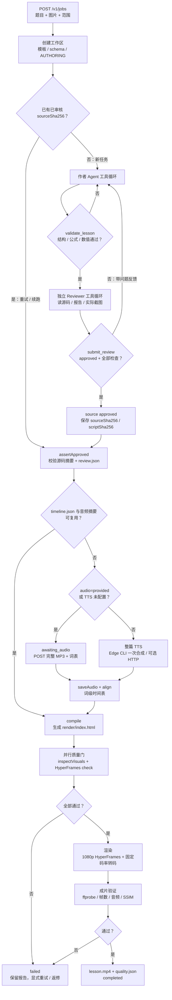
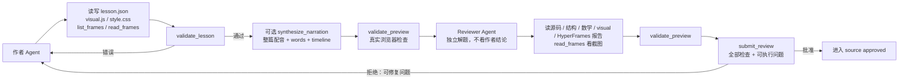

# 理象工作流程

本文档描述当前代码（`core/jobs.ts`、`core/pi.ts`、`core/quality.ts`、`core/audio.ts`）的实际流程。终端里可以直接看下面的“纯文本流程”，支持 Mermaid 的 Markdown 预览器会渲染后面的图。

## 纯文本流程

```text
POST /v1/jobs
  -> 创建工作区（模板、schema、AUTHORING）
  -> 作者 Agent 工具循环
       -> validate_lesson
       -> 独立 Reviewer 工具循环
       -> submit_review（approved + textClean + reasoningClear + layoutClean）
       -> source approved
  -> 已有 timeline/音频且摘要一致？
       是 -> compile
       否 -> audio=provided / TTS 未配置？
              是 -> awaiting_audio（上传 MP3 + 词表）
              否 -> 整篇 TTS（Edge CLI 或 HTTP）
       -> saveAudio + align
       -> compile
  -> inspectVisuals + HyperFrames check（并行）
  -> 渲染 1080p + 固定码率转码
  -> ffprobe / 帧数 / 音频 / SSIM 验证
  -> lesson.mp4 + quality.json
  -> completed
```

## 任务主流程



## 作者 / 审核内部循环



## 阶段与产物

| 阶段 | 主要动作 | 主要产物/报告 |
| --- | --- | --- |
| `queued` | 排队 | `job.json` |
| `authoring` | 按 `scope.subject` 加载基础提示词 + 科目参考，作者读写源码、讲稿、模型 | `lesson.json`、`src/visual.js`、`src/style.css` |
| `verifying` | `validateWorkspace`：schema、结构、数学断言 | `reports/structure.json`、`reports/math.json` |
| `reviewing` | 独立 reviewer 使用同科目参考，先文字、再逻辑、再易懂性、最后版式；读文件/看帧并提交审核 | `reports/review.json`、`reports/review-N.json` |
| `synthesizing` | 整篇 TTS（或复用已有音频） | `render/assets/audio/narration.mp3`、`words.json` |
| `awaiting_audio` | 等待外部 MP3 + 词表上传 | 等待 `POST /v1/jobs/:id/audio` |
| `aligning` | 词级时间表对齐并绑定音频摘要 | `timeline.json`、`reports/alignment.json` |
| `building` | 编译 HyperFrames 项目 | `render/index.html`、`assets/*` |
| `checking` | 浏览器视觉检查 + HyperFrames 检查 | `reports/visual.json`、`reports/hyperframes.json`、`reports/frames/*` |
| `rendering` | HyperFrames 1080p 渲染 + 固定码率转码 | `pending.mp4`（完成后变为 `lesson.mp4`） |
| `validating` | 成片规格、音频、SSIM 验证 | `reports/video.json` |
| `completed` | 生成最终质量记录 | `lesson.mp4`、`reports/quality.json` |

失败时会进入 `failed`，报告保留；`cancelled` 会中止当前模型/TTS/渲染进程。

## 当前质量门

- **内容门**：schema、结构、数学断言、独立审核；源码改动后摘要失效，必须重新审核。
- **视觉门**：字幕/高亮 cue、文字互相重叠、标签压住自己的点、越界裁切、乱码/控制字符、KaTeX 错误、主题背景、任意 seek 确定性。
- **HyperFrames 门**：真实浏览器检查 + 转场检查。
- **成片门**：1920×1080、帧率/总帧数、音频非静音、无异常黑帧、编码帧与参考帧 SSIM ≥ 0.97。
- **审核门**：`approved=true`，且 `textClean`、`reasoningClear`、`layoutClean` 等全部检查为 true；reviewer 必须先逐字校对文字，再检查逐项讲解逻辑和易懂性，最后查看实际截图。审核报告还绑定 reviewer 提示词摘要，提示词变更后旧批准失效。存在错字、逻辑跳跃、提前给结论、重叠/乱码/裁切都不能通过。

## 当前默认配置

- 视觉：默认浅色纸面主题（`#F7F5EE` 纸面、`#20201C` 正文）。
- 配音：`TTS_PROVIDER=edge`，按需启动一次性 Python Edge TTS 进程，无常驻 4311 服务；也可用 `http` + `TTS_URL`。
- 渲染：HyperFrames 1080p，渲染后按 `REASONFRAME_RENDER_BITRATE`（默认 `8M`）做固定码率转码。
- 模型：按 `.env` 当前配置的 LLM 参数执行；作者和审核使用独立会话。
