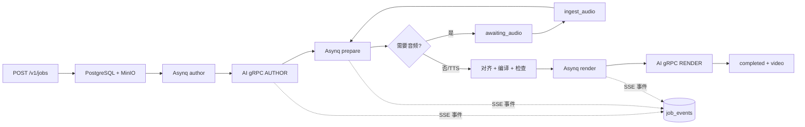

# 理象工作流程

本文档描述当前 Go 控制面与 `ai-service/` 执行面的实际流程。旧的 Express 单进程入口和 `JobManager`/`JobStore` 已移除，生产任务由 Go worker 编排。

## 总流程

```text
POST /v1/jobs
  -> Go API 校验输入，图片写入 MinIO，任务写入 PostgreSQL
  -> 入队 Asynq author
  -> Go worker 领取任务，调用 AI gRPC RunTask(AUTHOR)
       -> 答案 agent 解题，写 answer.json（答案、claims、model、solution、旁白）
       -> 独立答案 reviewer（每轮全新上下文）审核答案/推理/讲稿
       -> 上传已批准答案、讲稿、审核与检查报告
  -> 入队 prepare
       -> 整篇 TTS，或进入 awaiting_audio 等待 MP3 + 词表
       -> ingest_audio 校验词表与音频
       -> 视频 agent 把已批准答案/旁白转成 lesson.json + visual.js + style.css
       -> 真实编译/预览帧 + 独立视频 reviewer（每轮全新上下文）
       -> 词级对齐重算、编译、浏览器/HyperFrames 检查
  -> 入队 render
       -> 渲染、转码、成片验证、发布 video artifact
  -> 状态/事件写 PostgreSQL，SSE 按 event id 重放
  -> completed
```



## 阶段

| 阶段 | 执行方 | 主要动作 | 产物/检查点 |
| --- | --- | --- | --- |
| `queued` | Go | 入队 author 或当前恢复阶段 | job 记录、created 事件 |
| `author` | AI `src/tasks/author.ts` | 答案 agent 写 `answer.json`；结构/公式/数值校验；独立答案审核；内容返修 | 已批准答案、讲稿、答案审核/结构/数学报告，`answer_sha256`、`script_sha256`、AUTHOR `source_sha256` |
| `prepare` | AI `src/tasks/prepare.ts` | 复用或整篇 TTS；视频 agent 生成 `lesson.json`/`visual.js`/`style.css`；真实预览帧与独立视频审核；重对齐、编译、视觉与 HyperFrames 检查 | 视频源码、视频审核、音频、词表、时间线、字幕、检查报告，`source_sha256`、`audio_sha256`、`timeline_sha256` |
| `awaiting_audio` | Go/AI | 无 TTS 或 `audio=provided` 时等待上传；上传后执行 `ingest_audio` | MP3、词表、对齐报告 |
| `render` | AI `src/tasks/render.ts` | 重编译并核对 build 摘要；复用已验证视频或重新渲染；成片验证 | `lesson.mp4`、`quality.json`、`video_sha256` |
| `completed` | Go | 发布可下载产物，写终态事件 | 最终任务状态 |

## 答案 / 视频内部循环

```mermaid
flowchart LR
  A[答案 Agent 会话] --> B[写 answer.json]
  B --> C[validate_answer]
  C -- 错误 --> A
  C -- 通过 --> D[全新答案 Reviewer]
  D --> E[只读 answer / request / 报告]
  E --> F[submit_answer_review]
  F -- 拒绝 --> A
  F -- 批准 --> G[answer approved]
  G --> H[PREPARE: TTS / awaiting_audio]
  H --> I[视频 Agent 会话]
  I --> J[写 lesson / visual / style]
  J --> K[重对齐 + 编译 + 真实预览帧]
  K -- 检查失败 --> I
  K --> L[全新视频 Reviewer]
  L --> M[看实际帧 / 源码 / 报告]
  M --> N[submit_video_review]
  N -- 拒绝 --> I
  N -- 批准 --> O[video source approved]
```



- 答案作者和视频作者的 Pi 会话分别在各自的返修轮次之间保留，审核反馈作为新用户消息追加。
- 每次 reviewer 调用都创建新的 Pi 会话，只携带当前阶段的只读工具和产物，不共享作者对话。
- 答案审核只审核答案、推理、文字和旁白；视频审核必须核对已批准答案，并查看真实渲染预览帧。
- 视频作者不能改写已批准答案或旁白；若视频审核确认答案本身有问题，返修回到答案阶段。
- 审核报告绑定答案/源码/讲稿摘要与 reviewer 提示词摘要；任一摘要变化后旧批准失效。

## 自动返修

- 内容问题分别在答案循环和视频循环内部按 `REASONFRAME_AGENT_MAX_ATTEMPTS` 返修；两个作者会话在各自循环内保留。
- 视觉或 HyperFrames 检查失败且仍有 `auto_repairs` 预算时，Go 把任务退回 author，写入 `repair.queued`；AI 恢复上一版答案/源码和检查报告后重新答案/视频循环，再重新 prepare。
- `VIDEO_CHECK_FAILED` 可在 render 阶段重试一次；仍失败则任务失败。
- 讲稿不变时复用已验证音频；源码/时间线/编译器/质量检查器摘要都匹配时才复用已验证视频。

## 质量门

- **内容**：schema、结构、公式、数值断言、独立审核；审核必须逐字校对文字，再检查逻辑、易懂性和版式。
- **视觉**：字幕/高亮 cue、文字重叠、标签遮挡、越界、KaTeX 错误、主题背景、任意 seek 确定性。
- **HyperFrames**：真实浏览器检查、动画与过渡采样。
- **成片**：1920×1080、帧率/帧数、音轨、完整解码、异常黑帧/静音、逐场景 SSIM ≥ 0.97。
- **绑定**：源码、审核提示词、音频、时间线、构建清单和视频摘要必须一起匹配。

数值检查和模型审核是质量证据，不是数学形式化证明。当前已验证样例见 `ai-service/examples/`。
